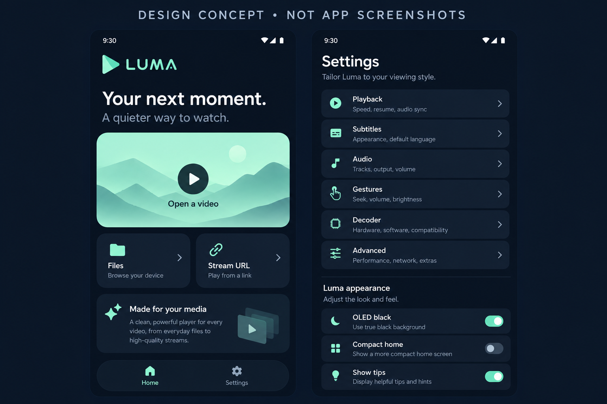

# Luma Player

مشغل Android مشتق من [mpvKt](https://github.com/abdallahmehiz/mpvKt)، بمحرك
`io.github.abdallahmehiz:mpv-android-lib:0.1.9` نفسه، وواجهة Compose جديدة بألوان ليلية ونعناعية.
لم نغيّر إصدار المحرك دون اختبار توافقه. المصدر الأصلي وترخيص Apache-2.0 محفوظان في `NOTICE` و`LICENSE`.

## ما تغير

- شاشة رئيسية ببطاقات مستديرة لفتح فيديو أو صوت، تصفح مجلد، وتشغيل رابط.
- فهرس إعدادات ببطاقات، وأزرار تحكم عائمة داكنة بحجم لمس لا يقل عن 48dp.
- وضع داكن افتراضي، مع الإبقاء على الوضع الفاتح وألوان النظام.
- خيارات جديدة محفوظة: سواد OLED، واجهة رئيسية مختصرة، وإظهار النصائح.
- نصوص الإضافات بالعربية والإنجليزية مع RTL وفق لغة الجهاز.
- الإعدادات الأصلية محفوظة: المشغل، الصوت، الترجمة، الإيماءات، فك الترميز، الأزرار المخصصة، وmpv المتقدم.



الصورة تصور بصري مولد وليست screenshot من جهاز. التنفيذ الحالي لا يطابق كل تفاصيل الصورة،
خصوصًا شريط التنقل والرسوم التوضيحية. تفاصيل التقاط لقطات حقيقية في [دليل التصميم](docs/design/README.md).

## بناء APK دون Secrets

من تبويب **Actions → Build Luma APKs → Run workflow**، أو عند push/pull request،
يعمل [.github/workflows/build-apk.yml](.github/workflows/build-apk.yml) على:

1. تجهيز JDK 17 وAndroid SDK 36 وBuild Tools 35.
2. تشغيل `testDebugUnitTest lintDebug assembleDebug assemblePreview`.
3. فحص توقيع APK ووجود مكتبات `.so` لكل معمارية.
4. رفع ملفات **Luma-arm64-64bit** و**Luma-armv7-32bit** ونسخة universal مع SHA-256.

لا توجد أي مراجع إلى `secrets` في YAML. نسخ Preview قابلة للتثبيت بتوقيع debug تلقائي،
ومعرفها `io.github.jntynho.luma.preview`. لا تحتاج المتاجر أو GitHub Releases إلى تفعيل لاستخدام artifacts.
**هذه ليست نسخ نشر إنتاجية:** المفتاح التجريبي قد يتغير بين تشغيلات CI، لذلك قد تحتاج إزالة النسخة السابقة
قبل تثبيت نسخة جديدة. النشر الرسمي بتحديثات ثابتة يحتاج مفتاح توقيع دائمًا وخطة توزيع مستقلة.

## التطوير المحلي

يتطلب JDK 17، Android SDK platform 36 وbuild-tools 35.0.0، واتصالًا بـGoogle Maven وMaven Central
وGradle وJitPack. استخدم checkout الموجود مباشرة، دون إنشاء worktree إضافي.

```sh
chmod +x gradlew
./gradlew --no-daemon --max-workers=2 testDebugUnitTest lintDebug assembleDebug assemblePreview
```

توجد ملفات APK تحت `app/build/outputs/apk/preview/` بعد نجاح البناء.
لا حاجة إلى API keys أو خدمات خارجية لتشغيل الوسائط المحلية. الحد الأدنى Android 5.0 (API 21).

## حالة التحقق في هذه البيئة

- تم تثبيت JDK 17 وGradle 8.14.2 وAndroid SDK 36.
- نجح اختبارا JUnit للتحقق من الروابط، بتشغيل Kotlin/JUnit مباشرة خارج Android Gradle.
- فُحصت مكتبة المحرك الأصلية وتحتوي فعلًا على ARM64 وARMv7.
- **بناء APK وAndroid lint واختبارات Gradle محجوبة** بسبب رفض الشبكة الوصول إلى JitPack (HTTP 403)،
  الذي يزود `seeker:2.0.1` و`Fuck-Storage-Access-Framework:1.1.3`.
- لم يُختبر التشغيل على جهاز أو محاكي، ولم تُنفذ GitHub Actions في هذه الجلسة حتى توثيق هذا الملف.
- لم يُنشر APK أو إصدار متجر. لا يوجد ادعاء بخلو التطبيق من العيوب.

بعد السماح بـ`jitpack.io` أعد أمر البناء أعلاه، ثم اختبر فيديو محليًا وبثًا شبكيًا، الترجمة والصوت،
التدوير وPiP والإيماءات على جهاز ARM64 وآخر ARMv7. راجع تراخيص المكونات الأصلية قبل التوزيع العام.
